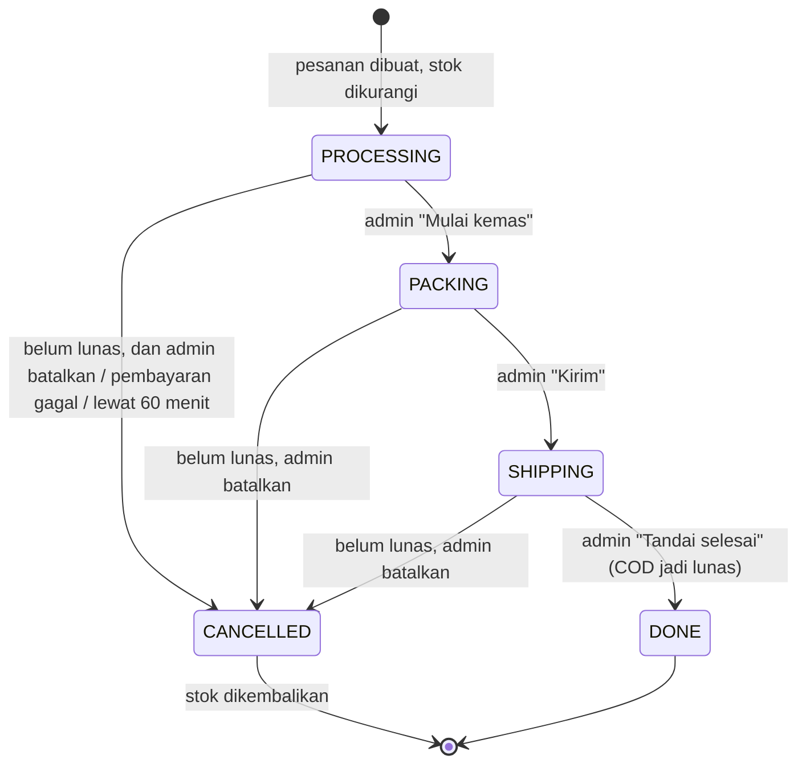

# Dokumentasi desain

## Skema database

Sumber kebenarannya adalah [`server/prisma/schema.prisma`](../server/prisma/schema.prisma). Diagram ini meringkasnya.

```mermaid
erDiagram
    User ||--o{ Address : punya
    User ||--o{ CartItem : "isi keranjang"
    User ||--o{ Order : memesan
    User ||--o{ Favorite : menyimpan
    Product ||--o{ Favorite : ""
    Product ||--o{ CartItem : ""
    Product ||--o{ OrderItem : ""
    Address ||--o{ Order : "dikirim ke"
    Order ||--|{ OrderItem : berisi

    User {
        string id PK
        string name
        string email UK
        string passwordHash
    }
    Product {
        string id PK
        string name
        string[] description
        int price "rupiah"
        int offerPrice "rupiah"
        string[] images
        string category
        int stock
        int massGrams
        datetime expiredAt "boleh kosong"
    }
    Address {
        string id PK
        string userId FK
        string street
        string city
        string zipcode "teks, bisa diawali 0"
        string phone
    }
    CartItem {
        string userId PK,FK
        string productId PK,FK
        int quantity
    }
    Favorite {
        string userId PK,FK
        string productId PK,FK
        datetime createdAt
    }
    Order {
        string id PK
        string userId FK
        string addressId FK
        int amount "rupiah"
        enum paymentType "COD | ONLINE"
        bool isPaid
        enum status "PROCESSING | PACKING | SHIPPING | DONE | CANCELLED"
        string snapToken "token Midtrans, boleh kosong"
        string paymentRef "order_id di Midtrans, unik per percobaan bayar"
        datetime paymentStartedAt "awal batas 60 menit"
    }
    OrderItem {
        string id PK
        string orderId FK
        string productId FK
        int quantity
        int unitPrice "harga saat dibeli"
    }
```

## Alur status pesanan

Pesanan online hanya bisa maju setelah lunas.

## Diagram draw.io

Folder `activity/`, `usecase/`, dan `navigation/` berisi diagram desain awal (2025), dibuka dengan [draw.io](https://app.diagrams.net). Alurnya masih sesuai, dengan dua perbedaan:

- Setelah login, admin sekarang masuk ke halaman **Pesanan**, bukan Tambah Produk.
- Login dan daftar pembeli berupa dialog, bukan halaman sendiri.

Class diagram lama (model MongoDB) sudah diganti dengan skema database di atas.
