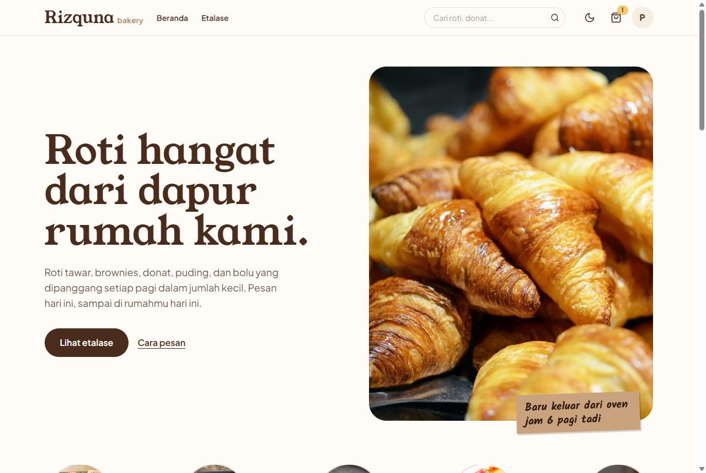
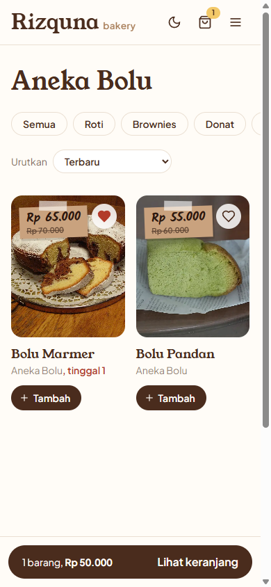
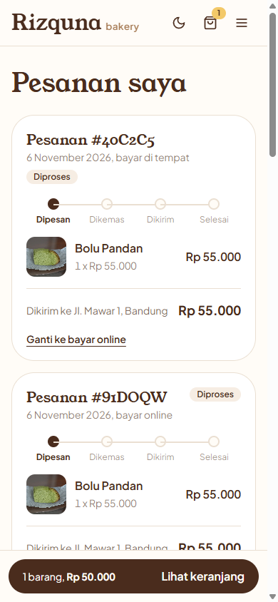
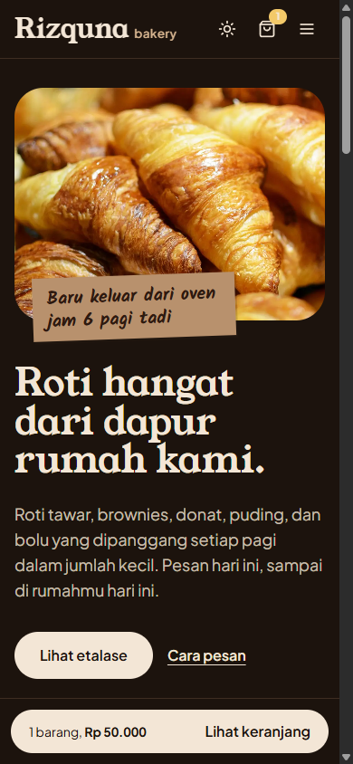
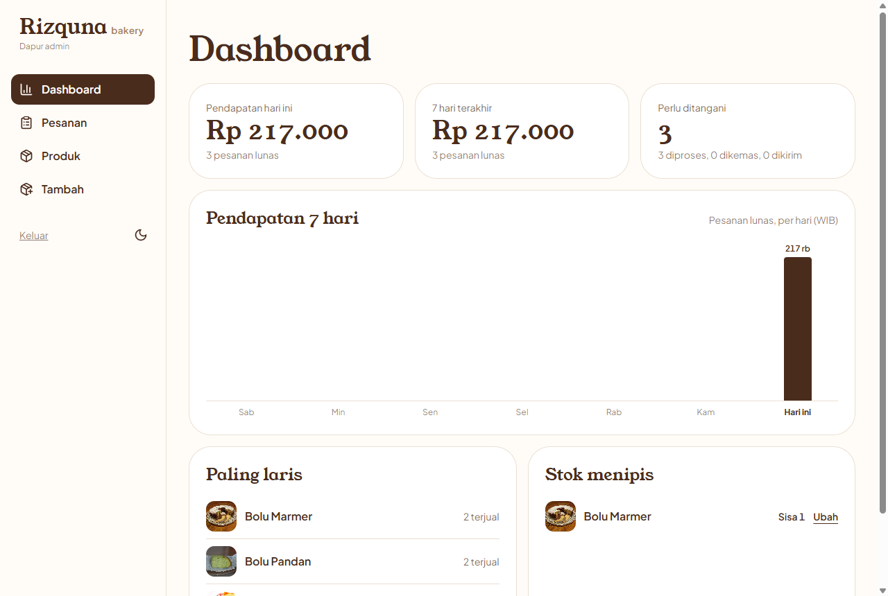

# Rizquna Bakery

Toko roti online untuk sebuah toko roti rumahan: pembeli melihat etalase, mengisi keranjang, lalu bayar di tempat atau bayar online. Penjual mengelola produk dan memproses pesanan dari dapur admin.

> Proyek portfolio. Pembayaran online memakai **Midtrans sandbox**, jadi tidak ada uang sungguhan yang berpindah.

**Demo:** _menyusul setelah deploy_

| Akun | Email | Password |
|---|---|---|
| Pembeli | `demo@rizquna.test` | `demo12345` |
| Admin (`/seller`) | dari `SELLER_EMAIL` | dari `SELLER_PASSWORD` |

Untuk mencoba bayar online, pakai kartu test Midtrans: `4811 1111 1111 1114`, masa berlaku bulan/tahun apa saja di masa depan, CVV `123`.



<p>
  
  
  
</p>



## Fitur

**Pembeli**
- Etalase per kategori, pencarian, dan urutan (terbaru, termurah, termahal). Filter tersimpan di URL, jadi bisa dibagikan.
- Favorit: tanda hati di setiap produk, tersimpan di akun.
- Keranjang yang tidak hilang saat halaman dimuat ulang. Tamu disimpan di browser, akun disimpan di server, dan keduanya digabung saat login.
- Checkout tiga langkah: pesanan, alamat, pembayaran. Bayar di tempat (COD) atau online lewat Midtrans Snap.
- Pesanan saya: perjalanan status (dipesan, dikemas, dikirim, selesai) dan tombol "Bayar sekarang" untuk pesanan online yang belum dibayar.
- Ganti metode bayar setelah memesan, selama pesanan belum dibayar dan belum dikemas. Dari online ke COD, pembayaran Midtrans yang terbuka ditutup dulu. Dari COD ke online, transaksi baru dibuat dengan referensi baru, karena Midtrans tidak menerima order_id yang sama dua kali.
- Mode terang dan gelap. Default-nya mengikuti tema perangkat.

**Admin**
- Dashboard: pendapatan hari ini dan 7 hari terakhir per hari (zona waktu WIB), pesanan yang perlu ditangani, produk terlaris, dan stok menipis.
- Daftar pesanan dengan filter status. Status hanya bisa maju: diproses, dikemas, dikirim, selesai. Pesanan yang belum dibayar bisa dibatalkan dan stoknya kembali.
- Tambah produk dengan foto (Cloudinary), ubah harga dan stok.

## Stack

| Bagian | Teknologi |
|---|---|
| Frontend | React 19, TypeScript, Vite, Tailwind CSS 4, React Router |
| Backend | Node.js, Express 5, TypeScript, Zod |
| Database | PostgreSQL dengan Prisma 7 (Docker di lokal, Neon di produksi) |
| Layanan | Midtrans Snap (sandbox), Cloudinary |
| Test | Vitest, terhadap PostgreSQL sungguhan |

Semua layanan di atas memakai paket gratis.

## Keputusan teknis

**Stok tidak bisa terjual dua kali.** Membuat pesanan berjalan dalam satu transaksi database. Stok dikurangi dengan `UPDATE ... WHERE stock >= jumlah`, jadi kalau dua pembeli berebut barang terakhir, hanya satu yang berhasil. Test `lets only one of two buyers take the last item` membuktikannya.

**Harga selalu dari server.** Browser hanya mengirim ID produk dan jumlah. Total dihitung dari harga di database, dan harga saat beli disimpan per baris pesanan (`OrderItem.unitPrice`), jadi riwayat tidak berubah kalau harga naik. Uang disimpan sebagai rupiah bulat (`Int`), tidak pernah sebagai float.

**Pesanan online belum lunas sampai Midtrans bilang lunas.** Status lunas hanya berubah lewat notifikasi Midtrans yang tanda tangannya cocok (dibandingkan dengan `timingSafeEqual`), atau lewat pengecekan langsung ke API Midtrans. Pesanan yang tidak dibayar dalam 60 menit dibatalkan dan stoknya dikembalikan.

**Identitas dari cookie, bukan dari body.** Setiap endpoint pembeli mengambil `userId` dari cookie JWT `httpOnly`, dan alamat dicek milik pembeli itu. Frontend dan API berada di satu domain (proxy Vite di lokal, rewrite Vercel di produksi), jadi cookie tidak dianggap cookie pihak ketiga dan cukup `SameSite=Lax`.

**Input divalidasi di pintu masuk.** Semua body request dicek dengan Zod: jumlah barang harus bilangan bulat 1 sampai 99, kode pos 5 angka, dan seterusnya. Pesan error ke browser selalu umum, sedangkan detailnya dicatat di log server.

## Menjalankan di lokal

Butuh Node.js 22 atau lebih baru, dan Docker.

```bash
# 1. Database
docker compose up -d

# 2. Backend
cd server
cp .env.example .env          # isi JWT_SECRET, SELLER_*, CLOUDINARY_*, MIDTRANS_SERVER_KEY
npm install
npm run db:migrate            # buat tabel
npm run db:seed               # 10 produk contoh + akun demo
npm run dev                   # http://localhost:3000

# 3. Frontend (terminal baru)
cd client
cp .env.example .env          # isi VITE_MIDTRANS_CLIENT_KEY
npm install
npm run dev                   # http://localhost:5173
```

Frontend meneruskan `/api` ke `localhost:3000`, jadi tidak perlu mengatur URL backend.

Notifikasi Midtrans tidak bisa mencapai `localhost`. Di lokal, status pembayaran dicek otomatis saat halaman "Pesanan saya" dibuka.

## Test

```bash
cd server
npm test
```

Test memakai database terpisah (`rizquna_test`) di PostgreSQL Docker yang sama, dibuat otomatis. Yang dites adalah aturan yang menyangkut uang dan stok: total pesanan, pengurangan stok, jumlah tidak valid, alamat milik orang lain, rebutan stok terakhir, pembatalan, batas waktu pembayaran, tanda tangan Midtrans, ganti metode bayar, ringkasan penjualan per hari WIB, dan favorit. Panggilan ke Midtrans di-mock di test.

## Struktur

```
client/                 React + Vite
  src/pages/            halaman pembeli, dan seller/ untuk admin
  src/components/       layout, etalase (Shelf), komponen kecil
  src/context/          state login, produk, dan keranjang
server/                 Express API
  prisma/               schema, migrasi, seed
  src/orders.ts         aturan pesanan, stok, dan pembayaran (dites)
  src/controllers/      handler per resource
  src/routes.ts         semua endpoint di satu tempat
docs/                   diagram desain dan skema database
```

Lihat [docs/README.md](docs/README.md) untuk diagram database dan diagram alur.
